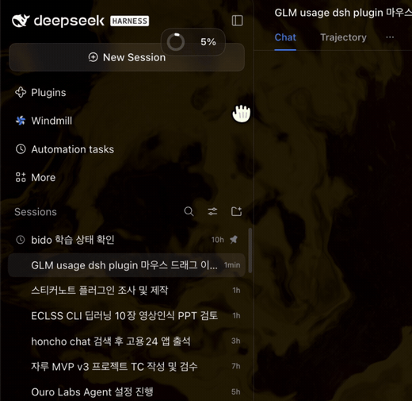

# @local/zai-usage-ring

Z.AI / GLM Coding Plan 사용량을 **원형 게이지(도넛 링)**로 표시하는
DeepSeek Harness(DSH) 웹 UI 플러그인입니다.



두 개의 네이티브 자리에 표시됩니다:

1. **채팅 입력창 툴바** (`conversation.input.left`) — 모델 선택 버튼
   왼쪽에 작은 링 게이지 + 백분율(가장 사용량이 높은 창)이 항상
   표시됩니다. 마우스를 올리면 각 창의 사용량 요약이, 클릭하면
   대시보드 패널이 열립니다.
2. **사이드바 패널** (`sidebar.panellist` + `main`) — 링 아이콘을 클릭하면
   중앙 메인 패널에 사용량 대시보드 페이지가 열립니다(Plugin Manager
   페이지와 같은 자리). 플랜의 각 사용 창마다 원형 게이지 카드가
   하나씩 표시됩니다:

- **5시간 창** (TOKENS_LIMIT unit=3) — 5시간 롤링 윈도 사용률
- **주간 풀** (TOKENS_LIMIT unit=6) — 주간 사용률
- **MCP / 도구** (TIME_LIMIT) — 월간 MCP·검색 도구 호출 수(사용/총량,
  도구별 세부 사용량 포함)

각 카드에는 사용률(%), 사용/총량(API가 제공할 때), 그리고
**리셋 카운트다운**(예: `2:14:05 후 리셋`)과 절대 리셋 시각이
함께 표시됩니다.

## 드래그로 위치 옮기기 (v1.1.0)

오버레이 위젯(캡슐)과 펼친 카드의 **헤더**는 드래그 핸들입니다:

- 캡슐/헤더를 누른 채 움직이면 위젯 전체(카드 포함)가 따라옵니다.
  새로고침·닫기 버튼 위에서 시작한 드래그는 무시됩니다.
- 4px 이상 움직였을 때만 드래그로 인식하므로, 짧게 클릭하면
  기존처럼 펼치기/닫기가 동작합니다.
- 위치는 브라우저 `localStorage`에 저장되어 페이지를 다시 열어도
  유지됩니다. 기본 위치(우하단)로 되돌리려면 브라우저 콘솔에서
  `localStorage.removeItem('zai-usage-ring:pos')` 후 새로고침하세요.
- 드래그로 옮긴 뒤에는 캡슐이 고정 앵커가 되고 카드는 캡슐
  아래로 펼쳐지며, 위젯이 항상 화면 안에 머물도록 자동 보정합니다
  (창 크기 변경 시에도).

## 작동 방식

- **호스트 반쪽**(`index.js`)이 Connection의 인증된 `/api` 채널에
  `POST /api/zai-usage-ring/usage` 라우트를 등록합니다.
- API 키는 호스트에서만 해석되며 브라우저로 전송되지 않습니다.
  브라우저는 이 플러그인의 라우트만 호출하고 정규화된 JSON 뷰만 받습니다.
- 업스트림: `GET https://api.z.ai/api/monitor/usage/quota/limit` (글로벌) 또는
  `GET https://open.bigmodel.cn/api/monitor/usage/quota/limit` (중국) —
  `Authorization: Bearer <key>`.
- 창 매핑: `TOKENS_LIMIT unit=3 → 5시간`, `unit=6 → 주간`, `TIME_LIMIT → MCP`.
  단위가 없는 행은 리셋 시각 순서로 폴백 배정됩니다(빠른 리셋 = 5시간 창).
- 브라우저 반쪽(`client.js`)은 세 슬롯에 등록합니다:
  `conversation.input.left`(컴포저 툴바의 compact 게이지, 모델 선택
  버튼 왼쪽), `sidebar.panellist`(사이드바 패널 아이콘), `main`
  (패널 페이지) — 모두 네이티브 자리입니다. 컴포저 게이지는 항상
  표시되고 60초마다 자동 새로 고침합니다(탭이 숨겨져 있으면 일시
  정지, 다시 보이면 즉시 갱신). 대시보드 페이지에도 수동 새로 고침
  버튼(↻)이 있습니다.
- 색상은 Harness 디자인 토큰만 사용해 라이트/다크 테마를 따르며,
  사용률 70% 이상 경고색, 90% 이상 오류색으로 바뀝니다.

## 자격증명 (기본값: 자동 탐지)

다음 중 하나가 해석되면 자동으로 나타납니다(둘 다 있으면 글로벌 우선):

| 사이트 | 자격증명 참조 | 엔드포인트 |
|---|---|---|
| 글로벌 (z.ai) | `ZAI_API_KEY` (그 다음 `GLM_CODING_API_KEY`) | `api.z.ai` |
| 중국 (bigmodel) | `ZAI_CODING_CN_API_KEY` (그 다음 `ZHIPU_CODING_API_KEY`) | `open.bigmodel.cn` |

`$DSH_HOME/.credentials.yaml` 또는 환경 변수에 설정하세요.

## 설정 (`cordis.patch.yml`의 `config`)

모든 키 선택 사항:

| 키 | 기본값 | 의미 |
|---|---|---|
| `site` | `auto` | `auto` / `global` / `cn` — 사이트 강제 지정 |
| `credential` | — | 명시적 자격증명 참조 (예: `ZAI_API_KEY`) |
| `apiKey` | — | 리터럴 키 (참조 방식 권장) |
| `timeoutMs` | `15000` | 업스트림 요청 타임아웃 |
| `refreshMs` | `60000` | 위젯 자동 새로 고침 주기(호스트 응답으로 전달) |

## 설치

번들이 있는 디렉터리에서:

```sh
dsh plugin --profile web add /path/to/zai-usage-ring
```

또는 Harness 에이전트에게 `plugin_manager` `install_bundle` 설치를 요청하세요.
설치 후 브라우저 페이지를 새로 고침하면 채팅 입력창 툴바(모델 선택 버튼
왼쪽)에 작은 링 게이지가 나타나고, 사이드바 패널 목록에도 아이콘이
추가됩니다. 둘 다 클릭하면 사용량 대시보드 페이지가 열립니다.
